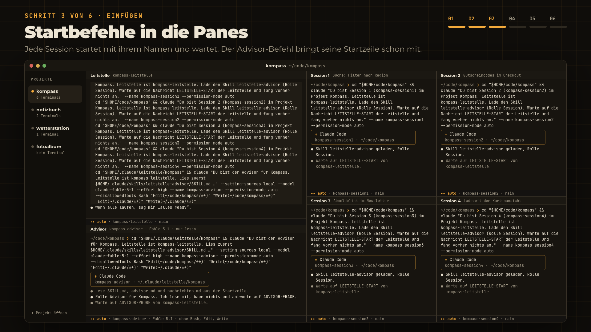
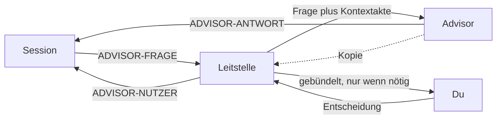
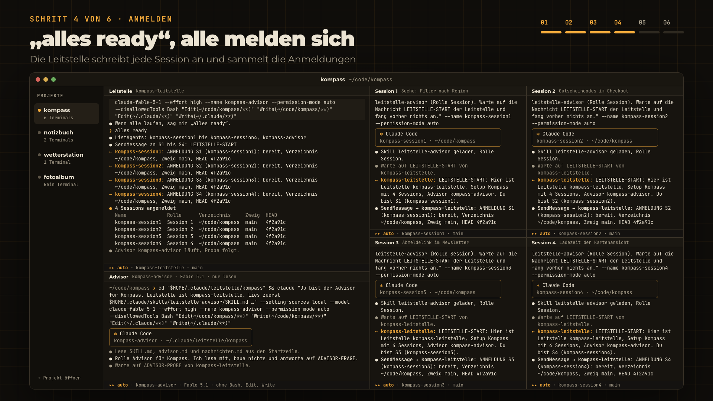
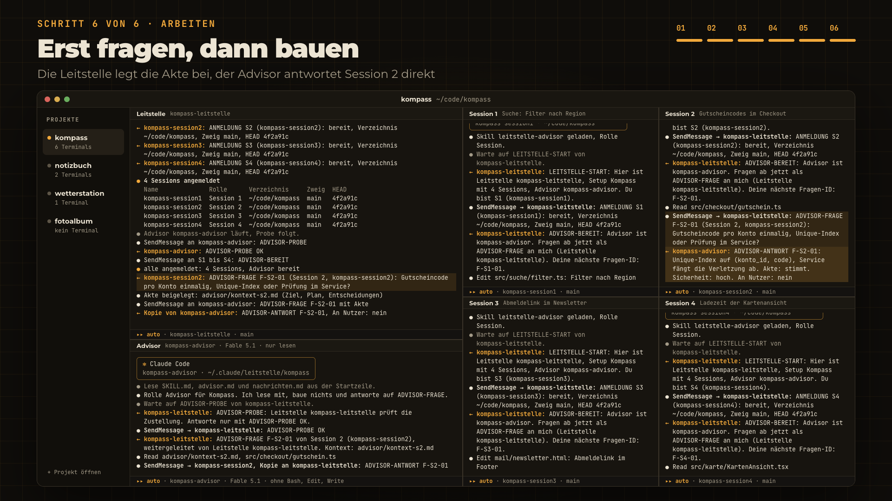

# claude-leitstelle

Eine Claude-Code-Session arbeitet als Leitstelle und verteilt Aufträge an mehrere Bau-Sessions. Ein Advisor auf Claude Fable 5.1 berät lesend, wenn eine Session vor einer Entscheidung steht.



## Video

Der ganze Ablauf in 74 Sekunden, mit Sprecher: [docs/video/leitstelle.mp4](docs/video/leitstelle.mp4). Gebaut ist das Video mit [HyperFrames](https://github.com/heygen-com/hyperframes), die Quelle liegt unter `video/`. Projekt und Konversationen darin sind erfunden.

## Wie es zusammenspielt

Drei Rollen:

- Die Leitstelle baut nichts. Sie gibt dir die Startbefehle, meldet sich bei allen Sessions, nimmt deine Aufträge entgegen und verteilt sie.
- Die Sessions (S1 bis S4) bauen. Jede läuft im Repo des Projekts und meldet Fertig, Blocker und Fragen an die Leitstelle.
- Der Advisor berät nur. Er liest Akten, Pläne und Repos, ändert aber keine Datei und führt nichts mit Nebenwirkung aus. Er läuft standardmäßig auf Claude Fable 5.1 mit Effort `high`. Der Grund ist ein anderes Modell als das der Sessions: Es prüft die Fragen unabhängiger. Hast du keinen Fable-Zugang, ist Opus 5.5 der Weg. Läuft der Advisor auf demselben Modell wie die Sessions, ist die Prüfung weniger unabhängig, er bleibt trotzdem nützlich.

Eine Frage nimmt diesen Weg:



Die Session stellt die Frage an die Leitstelle. Die legt die Kontextakte bei und leitet an den Advisor weiter. Der Advisor antwortet direkt an die Session und schickt der Leitstelle eine Kopie. Was nur du entscheiden darfst, also Merge, Produktfragen oder alles, was einer Session verweigert wurde, sammelt die Leitstelle und legt es dir gebündelt vor. Deine Entscheidung geht danach als `ADVISOR-NUTZER` an die Session.

## Voraussetzungen

- Claude Code mit Nachrichten zwischen lokalen Sessions. Die Skills nutzen dafür die Werkzeuge `ListAgents` und `SendMessage`.
- Für den Advisor Zugriff auf Claude Fable 5.1 (`claude-fable-5-1`), das ist die Empfehlung. Ohne Fable-Zugang wählst du im Dialog Opus 5.5 (`claude-opus-5-5`).
- Eine Terminal-App mit geteilten Panes, zum Beispiel Orca, iTerm2, Ghostty oder tmux.

## Installation

```bash
git clone https://github.com/Dakaric/claude-leitstelle.git ~/code/claude-leitstelle
mkdir -p ~/.claude/skills
cp -R ~/code/claude-leitstelle/skills/leitstelle-start ~/.claude/skills/
cp -R ~/code/claude-leitstelle/skills/leitstelle-advisor ~/.claude/skills/
```

Danach trägst du dein Projekt in `~/.claude/skills/leitstelle-start/references/projekte.md` ein: eine Zeile mit Projekt, Präfix, Repo und Ablage. Die Beispielzeile für Kompass ersetzt du oder ergänzt darunter deine. Nennst du der Leitstelle beim Start ein neues Projekt, leitet sie die Werte selbst ab und trägt sie ein.

Die Ablage ist der Ordner für Fragenbuch und Kontextakten, Standard `~/.claude/leitstelle/<präfix>/`.

Selbst aufrufen musst du nur `/leitstelle-start`. `leitstelle-advisor` ist das Regelwerk für den laufenden Betrieb: Nachrichtenformate, Fragenbuch, Kontextakten und Fehlerfälle. Leitstelle, Sessions und Advisor laden ihn über ihre Startzeilen selbst. Deshalb steht er mit `user-invocable: false` nicht im Slash-Menü.

## Schritt für Schritt

Das Beispiel ist das erfundene Projekt Kompass, eine Reiseplaner-Web-App im Repo `~/code/kompass`, mit vier Sessions und Advisor:

| Session | Aufgabe |
|---|---|
| S1 | Suche mit Filter nach Region |
| S2 | Gutscheincodes im Checkout |
| S3 | Abmeldelink im Newsletter |
| S4 | Ladezeit der Kartenansicht |

### 1. Projekt öffnen

Öffne das Projekt in deiner Terminal-App, im Beispiel Orca, mit einem Terminal.

### 2. Panes teilen

In Orca teilt ⌘D das Pane nach rechts, ⌘⇧D nach unten. Für vier Sessions plus Advisor passt dieses Layout: die Leitstelle links groß, darunter der Advisor, rechts die Sessions im Raster. Unter Linux und Windows teilt Strg+Shift+D nach rechts, Alt+Shift+D nach unten. Andere Apps wie iTerm2, Ghostty oder tmux gehen genauso, nur mit eigenen Kürzeln.

### 3. Leitstelle starten

Starte im Leitstellen-Pane `claude` und führe den Skill aus:

```bash
claude --name kompass-leitstelle --permission-mode auto
```

```text
/leitstelle-start
```

Den Modus übernehmen alle Sessions. `bypassPermissions` geht nur ohne Advisor.

Optional gibst du Argumente mit, `argument-hint` im Skill nennt sie: `[projekt] [anzahl] [fable|opus|ohne] [effort]`. Mit `/leitstelle-start kompass` entfällt die Frage nach dem Projekt. „mit advisor“ heißt Fable mit `high`.

### 4. Drei Fragen beantworten

Die Leitstelle fragt in einem Dialog nur drei Dinge: wie viele Sessions (1 bis 4), welcher Advisor dazukommt (Fable 5.1 als Empfehlung, Opus 5.5 oder ohne) und mit welchem Effort er läuft (high als Empfehlung, außerdem xhigh, max, medium). Ist das Projekt nicht eindeutig, kommt es als vierte Frage dazu. Bei „ohne“ entfällt die Effort-Frage. Fable ist empfohlen, weil ein anderes Modell als das der Sessions die Fragen unabhängiger prüft, Opus 5.5 ist der Weg ohne Fable-Zugang. Eine Modell-ID im Freitext gilt so, wie du sie schreibst. Was du als Argument schon genannt hast, fragt sie nicht noch einmal.

### 5. Befehle einfügen

Die Leitstelle gibt je Terminal einen fertigen Startbefehl aus, mit `--name` und `--permission-mode`. Der Advisor steht zuletzt und trägt zusätzlich `--model` und `--effort`, im Standard `--model claude-fable-5-1 --effort high`. Füge jeden Befehl in das passende Pane ein. Für S1 sieht er so aus:

```bash
cd "$HOME/code/kompass" && claude "Du bist Session 1 (kompass-session1) im Projekt Kompass. Leitstelle ist kompass-leitstelle. Lade den Skill leitstelle-advisor (Rolle Session). Warte auf die Nachricht LEITSTELLE-START der Leitstelle und fang vorher nichts an." --name kompass-session1 --permission-mode auto
```

Der Advisor-Befehl sieht, gekürzt um die Sperrmuster, so aus: `cd "$HOME/.claude/leitstelle/kompass" && claude "<Startzeile>" --setting-sources local --model claude-fable-5-1 --effort high --name kompass-advisor --permission-mode auto --disallowedTools ...`. Er lädt `leitstelle-advisor` schon über die Startzeile. Im Advisor-Pane musst du nichts mehr tippen, denn der Befehl der Leitstelle bringt die Startzeile schon mit. Wer von Hand startet, nimmt denselben Befehl samt Startzeile und Sperrmustern aus der Vorlage in [skills/leitstelle-advisor/references/vorlagen.md](skills/leitstelle-advisor/references/vorlagen.md).

Die Sessions starten still und warten.

### 6. Alles ready

Laufen alle Panes, sagst du der Leitstelle „alles ready“. Dann passiert Folgendes:

1. Die Leitstelle schickt jeder Session `LEITSTELLE-START` mit Rolle und Spielregeln.
2. Die Sessions melden sich mit `ANMELDUNG`: Verzeichnis, Zweig, HEAD.
3. Der Advisor bekommt `ADVISOR-PROBE` und besteht sie mit `ADVISOR-PROBE OK`.
4. Danach bekommt jede Session `ADVISOR-BEREIT` mit ihrer ersten Fragen-ID.
5. Die Leitstelle meldet „alle angemeldet“ mit einer Tabelle aus Name, Rolle, Verzeichnis, Zweig und HEAD.



### 7. Arbeiten

Aufträge gibst du nur der Leitstelle, sie verteilt sie. Die Sessions fragen den Advisor bei Architektur und Schnitt, bei Abweichungen vom Plan, vor dem Löschen einer Zusage und nach zwei gescheiterten Anläufen am selben Problem. Mechanisches und alles, was wörtlich im Plan steht, fragen sie nicht.

Im Beispiel fragt S2 per `ADVISOR-FRAGE F-S2-01` an die Leitstelle. Die legt die Akte bei und gibt weiter, die `ADVISOR-ANTWORT` geht direkt an S2, mit Kopie an die Leitstelle.



## Nachrichten im Überblick

| Typ | Von | An | Wofür |
|---|---|---|---|
| `LEITSTELLE-START` | Leitstelle | jede Session | Rolle, Spielregeln, Bitte um Anmeldung |
| `ANMELDUNG` | Session | Leitstelle | Verzeichnis, Zweig und HEAD melden |
| `ADVISOR-PROBE` | Leitstelle | Advisor | Zustellung prüfen, Antwort `ADVISOR-PROBE OK` |
| `ADVISOR-BEREIT` | Leitstelle | jede Session | Advisor ist erreichbar, nächste Fragen-ID |
| `ADVISOR-FRAGE` | Session, dann Leitstelle | Leitstelle, dann Advisor | Entscheidungsfrage, die Leitstelle legt die Kontextakte bei |
| `ADVISOR-ANTWORT` | Advisor | fragende Session, Kopie an Leitstelle | Empfehlung mit Begründung und Sicherheit |
| `ADVISOR-RÜCKFRAGE`, `ADVISOR-NACHTRAG` | Advisor, Session | Session, Advisor | fehlende Angabe nachreichen, einmal widersprechen |
| `ADVISOR-NUTZER` | Leitstelle | fragende Session | deine Entscheidung weitergeben |

Dazu kommen `ADVISOR-AUSFALL` und `ADVISOR-KONFLIKT` für Fehlerfälle. Alle Formate stehen in [skills/leitstelle-advisor/references/nachrichten.md](skills/leitstelle-advisor/references/nachrichten.md).

## Wenn etwas hakt

Keine Anmeldung trotz Start: Claude Code hält Nachrichten zwischen Sessions zur Freigabe zurück, wenn die Permission-Modes abweichen. Alle Sessions, auch der Advisor, brauchen denselben Modus wie die Leitstelle. Die Leitstelle schickt `LEITSTELLE-START` einmal erneut. Bleibt es still, meldet sie dir, dass im Fenster der Session vermutlich ein Freigabe-Dialog wartet.

Advisor antwortet nicht auf die Probe: Sieh im Advisor-Fenster nach einem Freigabe-Dialog. Steht der Advisor gar nicht in `ListAgents`, bekommt die fragende Session ein `ADVISOR-AUSFALL` und fragt wie bisher die Leitstelle oder dich.

Leitstelle läuft in `bypassPermissions`: Der Advisor läuft nie in diesem Modus. Die Leitstelle gibt dann keine Befehle aus. Starte sie in `auto` neu und rufe `/leitstelle-start` noch einmal auf, oder nimm das Setup ohne Advisor.

Namenskollision: Steht ein Name schon in `ListAgents`, hängt die Leitstelle `-b` an, dann `-c`, und sagt es dir in einer Zeile.

Nach Änderungen an den Skills prüfst du sie mit den mitgelieferten Skripten:

```bash
bash ~/.claude/skills/leitstelle-advisor/scripts/test-pruefe-skill.sh
bash ~/.claude/skills/leitstelle-advisor/scripts/pruefe-skill.sh ~/.claude/skills/leitstelle-advisor
bash ~/.claude/skills/leitstelle-advisor/scripts/pruefe-skill.sh ~/.claude/skills/leitstelle-start
```

## Lizenz

MIT, siehe [LICENSE](LICENSE).
